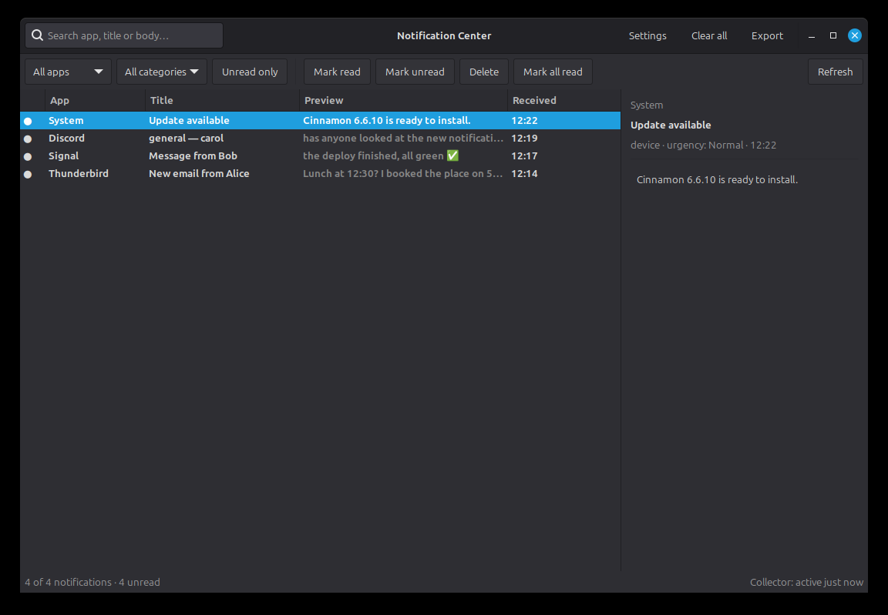

# Notification Center for Cinnamon

A persistent notification history for Cinnamon: record every desktop
notification, search it, mark things read, and get an unread badge in the panel.



*Screenshot uses temporary demo data.*

---

## What it does

- **Applet** — shows an unread count in the panel. Click it for a menu with
  *Open Notification Center* and *Open configuration file*; middle-click opens
  the viewer directly. If the collector is not running, the icon switches to a
  warning icon and the tooltip explains.
- **Viewer** — search across app, title and body; filter by app, category or
  unread; mark read/unread, mark all read, delete or clear all; export the
  current view as JSON. Launch it from the application menu or
  `notify-center-viewer`; double-click marks a notification read, and launching
  again focuses the existing window instead of opening a second copy.
- **Collector** — a small `systemd --user` service that turns spooled
  notifications into a local SQLite history with retention and size limits.

## How it works

Cinnamon already implements `org.freedesktop.Notifications`, so nothing outside
the shell can observe notifications. This applet hooks notification delivery
inside the Cinnamon applet (same JS process as the shell), writes one small
JSON file per notification, and the Python collector turns those files into
SQLite. Cinnamon's native notification UI is untouched.

```
application
    │ Notify() (still handled by Cinnamon)
    ▼
Cinnamon notificationDaemon._notifyForSource
    │ applet hook: write one JSON file
    ▼
~/.local/share/notify-center/spool/<timestamp>-<random>.json
    │ collector (systemd user service), poll every 2s
    ▼
~/.local/share/notify-center/notifications.db   (SQLite, WAL)
    │                         │
    │ status.json            │ read only
    ▼                         ▼
applet badge / tooltip      GTK viewer (search, filter, mark read, delete, export)
```

---

## Prerequisites

- Cinnamon 6.x (Linux Mint 22 or later)
- Python 3 with `sqlite3` (standard library)
- GTK 3 Python bindings for the viewer:
  `sudo apt install python3-gi gir1.2-gtk-3.0`
- A working `systemd --user` session for the collector (optional; see
  `--no-service`)

The collector itself uses **only** the Python standard library.

---

## Install

```bash
git clone https://github.com/jt-at-home/notify-center.git
cd notify-center
./install-notify-center.sh
```

Then add the applet:

1. Right-click the Cinnamon panel → **Applets**
2. Select **Notification Center** → **Add to panel**

If the applet does not appear in the list, reload Cinnamon (Alt+F2, `r`, Enter)

The collector service is enabled and started automatically. If `systemd --user`
is unavailable, install with `--no-service` and start the collector manually:

```bash
~/.local/bin/notify-center-collector &
```

The installer never overwrites an existing
`~/.config/notify-center/config.json`, and it refuses to run as root.

---

## Configuration

`~/.config/notify-center/config.json`:

```json
{
  "retention_days": 30,
  "max_rows": 5000,
  "ignore_transient": true,
  "ignore_apps": [],
  "persistent_apps": [],
  "persistent_categories": []
}
```

| Key | Used by | Meaning |
| --- | --- | --- |
| `retention_days` | collector | Delete notifications older than this (1–3650). |
| `max_rows` | collector | Keep at most this many rows (100–100000). |
| `ignore_transient` | applet + collector | Skip notifications carrying the `transient` hint. Default `true`; these are usually on-screen display popups, not history. Set to `false` to record every notification. |
| `ignore_apps` | applet + collector | Case-insensitive app names or `.desktop` ids that should not be recorded. |
| `persistent_apps` | applet | Optional. Apps whose notifications should **not** auto-expire (stay in Cinnamon's tray until dismissed). Matches app name or desktop-entry id. Empty by default. |
| `persistent_categories` | applet | Optional. Same, by freedesktop category. A rule matches the category or its prefix (`im` matches `im.received`). Empty by default. |

History and the unread badge are the primary safety net: every recorded
notification remains searchable and contributes to the unread count even after
its popup and tray item are gone. The `persistent_*` lists are strictly opt-in
for the cases where you also want a notification parked in Cinnamon's tray.
They do not affect recording or the unread count.

`persistent_*` uses Cinnamon internals to remove the notification from its
expiry queue and mark it resident. If a future Cinnamon changes those internals,
the applet catches the error and continues recording.

---

## Files installed

```
~/.local/bin/notify-center-collector
~/.local/bin/notify-center-viewer
~/.local/share/cinnamon/applets/notification-center@jt-at-home/
~/.local/share/notify-center/notifications.db       # 0600
~/.local/share/notify-center/status.json            # 0600
~/.local/share/notify-center/spool/                 # 0700
~/.local/share/notify-center/failed/                # bad spool files
~/.config/notify-center/config.json
~/.config/systemd/user/notify-center-collector.service
~/.local/share/applications/notify-center.desktop
```

Uninstall (keeps history and config):

```bash
./uninstall-notify-center.sh
```

Uninstall and delete the database, spool and config:

```bash
./uninstall-notify-center.sh --purge
```

Add `--no-service` to skip all `systemctl --user` calls and only remove files,
for example in containers or throwaway prefixes where the unit is not managed
by this login session.

---

## CLI

Collector:

```bash
notify-center-collector                 # foreground, poll every 2s
notify-center-collector --once          # drain the spool and exit
notify-center-collector --verbose       # log every file
notify-center-collector --data-dir DIR --config FILE
notify-center-collector --poll 1.0      # faster polling
```

Viewer:

```bash
notify-center-viewer
notify-center-viewer --version
```

If `~/.local/bin` is not on your `PATH`, use `~/.local/bin/notify-center-viewer`.

---

## Troubleshooting

**Applet says "Collector is not running"**

```bash
systemctl --user status notify-center-collector.service
journalctl --user -u notify-center-collector.service -n 50 --no-pager
```

If you installed with `--no-service`, start the collector manually. If you use a
custom `XDG_DATA_HOME`, make sure the service sees the same value; the installer
writes it into the unit, but a service started manually from a different
environment may use a different path.

**No notifications appear**

- Confirm the applet is actually on the panel (Cinnamon only calls the hook for
  an added applet).
- Check the Cinnamon log for
  `Main.notificationDaemon._notifyForSource is unavailable`. If it appears, the
  private API changed; capture is disabled but the rest of the app still works.
- `ignore_transient` defaults to `true`; some apps mark all their notifications
  transient. Set it to `false` temporarily if you suspect this.
- Notifications that Cinnamon itself creates internally (not through the
  freedesktop API) are not seen; the applet only sees app notifications.
- History starts when the applet is added. There is no backfill of older
  notifications.

**Viewer says "No database yet"**

The collector has not run successfully. Start it, or run
`notify-center-collector --once` to create the database.

**Viewer fails with a GTK error**

This viewer is GTK 3 code and pins `gi.require_version("Gtk", "3.0")`. Install
the GTK 3 bindings:

```bash
sudo apt install python3-gi gir1.2-gtk-3.0
```

**The applet is not in the Applets list**

Confirm the files are in
`~/.local/share/cinnamon/applets/notification-center@jt-at-home/` and that
`metadata.json` has `"uuid": "notification-center@jt-at-home"`. Reload Cinnamon
(Alt+F2, `r`, Enter) if you copied the files by hand.

---

## Privacy

Notification bodies can contain message text, email subjects and 2FA codes. The
database and status file are created with mode `0600`; the data and spool
directories use `0700`. Nothing is sent off the machine. Set
`retention_days` and `max_rows` to keep history small, or run
`uninstall-notify-center.sh --purge` to remove it entirely.

---

## Limitations

- The applet relies on Cinnamon's private `_notifyForSource` hook. If a future
  Cinnamon changes it, notification capture is disabled but the rest of the
  app keeps working.
- Notification **actions** are stored as JSON and shown only as metadata. The
  viewer cannot invoke an action after the notification has expired.
- Cinnamon notification IDs are reused for replacements, which the collector
  coalesces into one row per logical notification per applet session.
- There is no tray icon in the viewer; the applet is the tray/panel presence.
  This avoids the deprecated X11-only `Gtk.StatusIcon`.
- The viewer and collector are separate processes. If the collector is stopped,
  the viewer still works on the existing database; new notifications are queued
  in the spool and drained when it restarts. The applet keeps at most 2000 spool
  files and drops anything older than 30 days, so a collector that never runs
  cannot fill the disk — the oldest queued notifications are discarded first.

---

## License

MIT. See [LICENSE](LICENSE).
